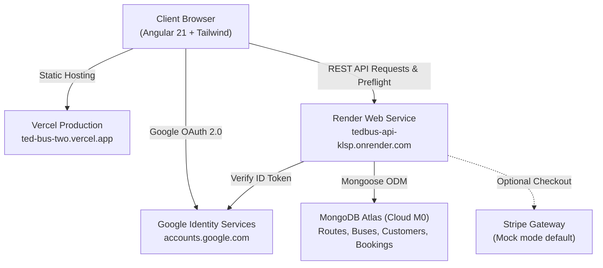

# 🚌 TedBus — Full-Stack Bus Ticket Booking Platform

[](https://ted-bus-two.vercel.app)
[](https://tedbus-api-klsp.onrender.com/api/health)
[](https://angular.dev)
[](https://expressjs.com/)
[](https://www.mongodb.com/)

A modern, production-deployed online bus ticketing platform inspired by RedBus. Built with an **Angular 21** single-page frontend (signals, standalone components, Tailwind CSS) backed by an **Express + MongoDB Atlas** REST API.

* 🌐 **Live Web App:** [https://ted-bus-two.vercel.app](https://ted-bus-two.vercel.app)
* ⚡ **Live API Service:** [https://tedbus-api-klsp.onrender.com](https://tedbus-api-klsp.onrender.com)
* 🩺 **API Health Endpoint:** [https://tedbus-api-klsp.onrender.com/api/health](https://tedbus-api-klsp.onrender.com/api/health)

---

## 🏗️ Architecture Overview



---

## ✨ Key Features

* **Route Discovery & Search:**
  * Dynamic city dropdowns with source & destination correlation.
  * 1-click city swap button.
  * Local calendar datepicker with past date protection.
* **Live Search & Filtering:**
  * Real-time filtering by bus type (*AC, Non-AC, Sleeper, Seater*).
  * Departure window slot filters (*Before 6 AM, 6 AM–12 PM, 12 PM–6 PM, After 6 PM*).
  * Sorting by fare, departure time, and customer ratings.
* **Interactive Seat Selection & Drawer:**
  * Interactive 40-seat deck with live disabled state for already-booked seats.
  * Real-time fare calculation with multi-seat selection limits.
  * Responsive, full-screen slide-in drawer for passenger details (*Name, Age, Gender* per seat).
* **Authentication & User Management:**
  * Google Sign-In with server-side ID token verification.
  * Customer syncing in MongoDB with profile picture and contact information.
* **Checkout & Payment:**
  * Order summary breakdown with taxes, insurance, and donations.
  * Instant mock gateway for demo transactions, with Stripe Checkout support.
* **Trip & Inventory Management:**
  * Profile dashboard tracking upcoming and completed trips.
  * 1-click booking cancellation that permanently frees seat inventory in MongoDB.

---

## 🛠️ Tech Stack

| Layer | Technology | Purpose |
|---|---|---|
| **Frontend** | Angular 21 (Signals & Standalone Components) | Reactive UI, client-side routing, and state management |
| **Styling** | Tailwind CSS + Angular Material | Modern, responsive mobile & desktop UI |
| **Backend** | Node.js + Express 4 (ES Modules) | RESTful API, authentication middleware, and business logic |
| **Database** | MongoDB Atlas (Mongoose 8) | Persistent document store for routes, buses, and bookings |
| **Security** | CORS with preflight handling, Google Auth Library | Multi-origin protection and token validation |
| **Deployment** | Vercel (Frontend) + Render (API) | Cloud serverless static frontend & managed Node backend |

---

## 📁 Repository Layout

```
TedBus/
├── backend/                      # Express REST API
│   ├── src/
│   │   ├── config/               # MongoDB Atlas connection
│   │   ├── controllers/          # Request handlers (booking, bus, customer, payment, route)
│   │   ├── middleware/           # Google auth verification, error handlers
│   │   ├── models/               # Mongoose schemas (Booking, Bus, Customer, Route)
│   │   ├── routes/               # Express routers
│   │   ├── services/             # Booking validation, access control
│   │   ├── app.js                # Express app setup & CORS policy
│   │   └── server.js             # API entrypoint
│   └── package.json
├── frontend/                     # Angular 21 Frontend
│   ├── src/
│   │   ├── app/
│   │   │   ├── Component/        # Landing page, bus selection, seat map, payment, profile
│   │   │   ├── model/            # TypeScript interfaces & fare calculators
│   │   │   └── service/          # HTTP API client, AuthService, filter state
│   │   └── environments/         # Dev and production API URLs
│   └── vercel.json               # Vercel SPA rewrites & cache headers
├── render.yaml                   # Render Blueprint configuration
├── tedbus-seed.js                # Database seeder script
├── DEPLOYMENT.md                 # Step-by-step deployment and verification guide
└── README.md
```

---

## 🚀 Local Development Setup

### 1. Prerequisites
* **Node.js** `>= 22.12.0`
* **npm**
* **MongoDB** (local `mongodb://127.0.0.1:27017` or MongoDB Atlas URI)
* `mongosh` CLI

### 2. Seed Database
```bash
mongosh "mongodb://127.0.0.1:27017/tedbus" tedbus-seed.js
```
*(Populates 12 routes, 26 buses, demo user, and initial trips).*

### 3. Start Backend API
```bash
cd backend
npm install
cp .env.example .env     # Update MONGODB_URI, GOOGLE_CLIENT_ID if desired
npm run dev              # Runs on http://localhost:3000
```
Verify with:
```bash
curl http://localhost:3000/api/health
```

### 4. Start Angular Frontend
```bash
cd frontend
npm install
npm start                # Runs on http://localhost:4200
```
Open **`http://localhost:4200`** in your browser.

---

## 📡 API Reference

| Method | Endpoint | Description |
|---|---|---|
| `GET` | `/` | API status and route directory |
| `GET` | `/api/health` | Service health, DB connection status, payment mode |
| `GET` | `/api/routes` | List all available travel routes |
| `GET` | `/api/routes/:from/:to/:date` | Get matching buses & occupied seat map for a date |
| `GET` | `/api/buses` | Get all registered buses |
| `POST` | `/api/customers` | Upsert customer record upon Google sign-in |
| `GET` | `/api/bookings/:customerId` | Retrieve all bookings for a user |
| `POST` | `/api/bookings` | Create a confirmed ticket booking |
| `PATCH` | `/api/bookings/:id/cancel` | Cancel and permanently remove a booking |
| `POST` | `/api/payments/checkout` | Create Stripe / Mock checkout session |

---

## 🧪 Testing

```bash
# Run Angular test suite
cd frontend
npx ng test --watch=false

# Test production build
npm run build
```

---

## 🚢 Deployment & Production Verification

For full instructions on configuring MongoDB Atlas, Render web services, Vercel SPA rewrites, and Google OAuth credentials, see **[DEPLOYMENT.md](DEPLOYMENT.md)**.
